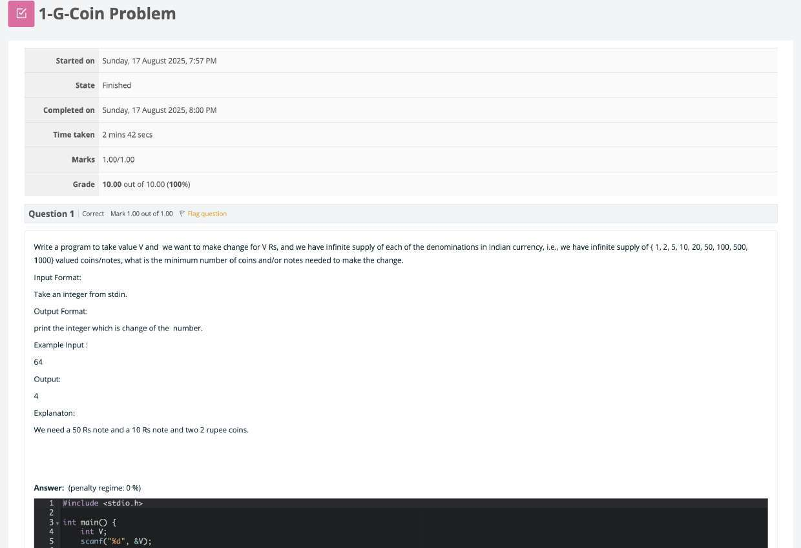
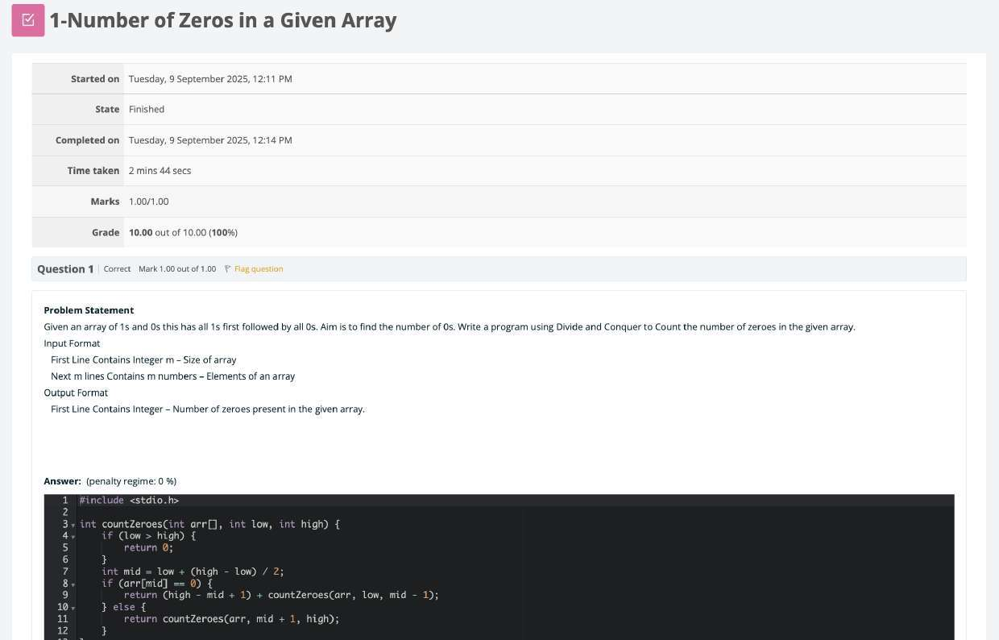
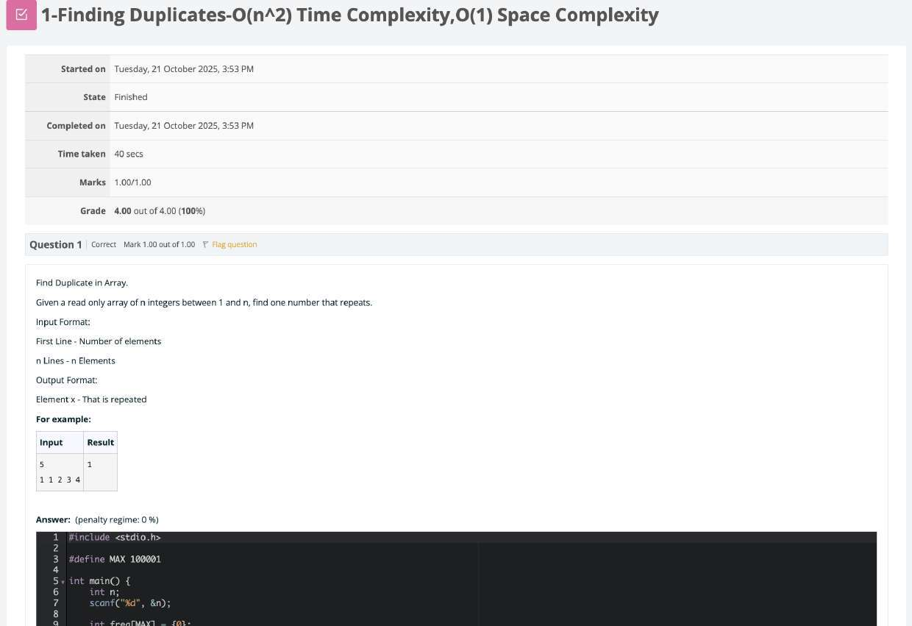

# Design and Analysis of Algorithms Laboratory

[](#)
[](#)
[](#)
[](#)

## 1. Project Title
**Design and Analysis of Algorithms Laboratory: Theoretical Formulations, Asymptotic Complexity Proofs, and Algorithmic Paradigms**

## 2. Project Overview
This repository contains a comprehensive academic laboratory curriculum in the **Design and Analysis of Algorithms (DAA)**. The collection encapsulates extensive theoretical derivations, asymptotic proofs, algorithmic design paradigms, and problem-solving solutions spanning core computational domains.

The modules systematically explore algorithmic strategies from initial recurrence relation modeling and fundamental C programming primitives to advanced algorithmic strategies including Divide and Conquer, Greedy optimization, Dynamic Programming, and Competitive Programming paradigms. Each module provides step-by-step pseudo-code, mathematical recurrence solving (Master Theorem, recursion trees), dry runs, space-time complexity classifications (Best, Average, Worst case), and boundary condition analyses.

---

## 3. Objectives
- Establish foundational algorithmic design principles, pointer mechanics, and dynamic memory allocation in C.
- Formulate mathematical techniques for asymptotic complexity analysis ($O, \Omega, \Theta$) and solve recurrence equations.
- Implement and analyze Divide-and-Conquer algorithms, evaluating recursive partition strategies and recurrence behavior.
- Investigate Greedy paradigms, proving the greedy-choice property and optimal substructure across combinatorial problems.
- Design Dynamic Programming solutions, contrasting top-down memoization against bottom-up tabulation to avoid overlapping subproblem re-computation.
- Explore competitive algorithmic patterns, optimizing execution runtime and memory under strict computational constraints.

---

## 4. Key Features
- **Rigorous Asymptotic Complexity Derivations**: Formal mathematical proofs utilizing limits, induction, recursion trees, and the Master Theorem.
- **Divide-and-Conquer Implementations**: Complete structural walkthroughs of sorting, searching, and divide-and-conquer matrix operations.
- **Greedy Optimization Solutions**: Step-by-step algorithms for minimum spanning trees, shortest paths, Huffman compression, and interval scheduling.
- **Dynamic Programming Formulations**: State definitions, recurrence relations, transition tables, and backtracking reconstructors for classical optimization problems.
- **Comparative Complexity Profiling**: Explicit breakdown of best, average, and worst-case time and space bounds for every algorithm.
- **Competitive Problem Solving**: High-performance algorithmic strategies for graph traversals, bit manipulation, and modular arithmetic.

---

## 5. Technologies Used
- **Theoretical Paradigms**: Asymptotic Analysis, Recurrence Relations, Greedy Method, Dynamic Programming, Divide and Conquer
- **Implementation Language**: C / C++ (C99 / C11)
- **Data Structures**: Arrays, Linked Lists, Heaps / Priority Queues, Binary Search Trees, Disjoint Set Union (DSU), Adjacency Matrices / Lists
- **Documentation Platform**: High-fidelity digitized algorithmic manuscripts and technical records

---

## 6. Project Structure
```text
DESIGN-ANALYSIS-OF-ALGORITHM-COURSE-/
│
├── BASIC C PROGRAMMING.pdf                   # Module 1: C Primitives, Pointers, Memory Allocation & Structures
├── Finding Time Complexity of Algorithms.pdf # Module 2: Asymptotic Notations, Recurrences & Master Theorem
├── Divide and Conquer.pdf                    # Module 3: Divide and Conquer (Merge Sort, Quick Sort, Binary Search)
├── Greedy Algorithms.pdf                     # Module 4: Greedy Method (Knapsack, Huffman, MST, Dijkstra)
├── Dynamic Programming.pdf                   # Module 5: Dynamic Programming (0/1 Knapsack, LCS, Matrix Chain)
├── Competitive Programming.pdf               # Module 6: Advanced Problem Solving, Graph Algorithms & Optimizations
│
├── docs/
│   └── images/                               # Sample manuscript pages and structural diagrams
│       ├── divide_and_conquer_sample_p1.png
│       ├── greedy_algorithms_sample_p1.png
│       └── dynamic_programming_sample_p1.png
│
└── README.md
```

---

## 7. Installation and Prerequisites
### Prerequisites
- GCC or Clang compiler (supporting C99 or later)
- Make or CMake build utilities (optional)
- Standard PDF viewer (such as Adobe Acrobat, Evince, or browser-integrated viewer)

### Compilation Command Example (C Programs)
```bash
gcc -O2 -Wall -Wextra algorithm_source.c -o algorithm_bin
./algorithm_bin
```

---

## 8. Execution Instructions
To review the theoretical proofs, pseudo-code derivations, and complexity tables:
1. Open any of the module PDF records in your preferred viewer.
2. Follow the sequence: **Problem Statement $\to$ Mathematical Formulation $\to$ Pseudo-code $\to$ Step-by-Step Trace $\to$ Complexity Derivation**.
3. To execute the underlying C implementations, compile using `gcc` as shown above.

---

## 9. Implementation and Methodology

| Module | Core Concepts & Algorithms | Problem Instances Covered | Time Complexity (Best / Avg / Worst) | Space Complexity |
|---|---|---|---|---|
| **Basic C Programming** | Pointers, Dynamic Memory (`malloc`/`free`), Structs, Recursion | Array manipulation, recursive traversal | $O(1)$ to $O(n)$ | $O(1)$ auxiliary |
| **Time Complexity** | Asymptotic bounds ($O, \Omega, \Theta$), Master Method, Recursion Tree | Linear loops, nested loops, divide-and-conquer recurrences | Analytical Proofs | Memory recursion stack |
| **Divide & Conquer** | Binary Search, Merge Sort, Quick Sort, Strassen's Multiplication | Sorting arrays, element searching, matrix multiplication | $\Omega(n \log n)$ / $\Theta(n \log n)$ / $O(n^2)$ | $O(\log n)$ to $O(n)$ |
| **Greedy Algorithms** | Fractional Knapsack, Activity Selection, Huffman, Kruskal, Prim, Dijkstra | Resource scheduling, optimal prefix codes, MST, shortest path | $O(n \log n)$ to $O(V^2)$ / $O(E \log V)$ | $O(V + E)$ |
| **Dynamic Programming** | 0/1 Knapsack, Longest Common Subsequence (LCS), Matrix Chain Mult. | Multi-stage optimization, sequence matching, parenthesization | $\Theta(n \cdot W)$, $\Theta(m \cdot n)$, $\Theta(n^3)$ | $\Theta(n \cdot W)$, $\Theta(m \cdot n)$ |
| **Competitive Programming** | Bitmasking, DSU, Fast I/O, Modular Arithmetic, Sieve of Eratosthenes | Subarray sum, prime factorization, connected components | Optimized for $O(1)$ to $O(n \log n)$ | Strict constraints |

---

## 10. Results and Outputs
- **Analytical Recurrence Solutions**: Demonstrated that divide-and-conquer recurrences of the form $T(n) = 2T(n/2) + \Theta(n)$ yield $O(n \log n)$ complexity using Master Theorem Case 2.
- **Partition Efficiency in Quick Sort**: Evaluated Lomuto vs. Hoare partitioning schemes, verifying average-case $\Theta(n \log n)$ performance and mitigating $O(n^2)$ degeneration through median-of-three pivot selection.
- **Greedy Optimality Proofs**: Confirmed that the greedy choice property holds for Fractional Knapsack but fails for 0/1 Knapsack, requiring Dynamic Programming.
- **Subproblem Overlap in DP**: Demonstrated reduction of exponential time complexity $O(2^n)$ in naive recursive Fibonacci/Knapsack to polynomial time $\Theta(n \cdot W)$ via state memoization.

---

## 11. Screenshots and Visual Documentation

### Divide and Conquer Module: Recursive Decomposition and Merge Strategies


### Greedy Algorithms Module: Optimal Substructure and Selection Policies


### Dynamic Programming Module: State Recurrence Formulation and Memoization Tables


---

## 12. Learning Outcomes
- Mastered rigorous asymptotic complexity analysis, recurrence solving, and computational trade-off evaluation.
- Gained deep practical intuition on recognizing whether a problem exhibits the greedy-choice property or requires dynamic programming state formulation.
- Developed the ability to structure clean, memory-safe algorithmic implementations in C.
- Strengthened algorithmic foundations for competitive programming and technical problem-solving.

---

## 13. Future Improvements
- Implement automated benchmark test suites in C/C++ measuring actual wall-clock execution time against input size ($n$).
- Add visualization scripts in Python/Matplotlib plotting empirical runtime curves against theoretical $O(n \log n)$ and $O(n^2)$ boundaries.
- Expand coverage to Advanced Graph Algorithms (Tarjan's strongly connected components, Ford-Fulkerson network flows).

---

## 14. Author
**Rohita M**  
- **GitHub**: [@rohitam26](https://github.com/rohitam26)  
- **Academic Program**: B.E. Artificial Intelligence and Machine Learning  
- **Institution**: Rajalakshmi Engineering College  
